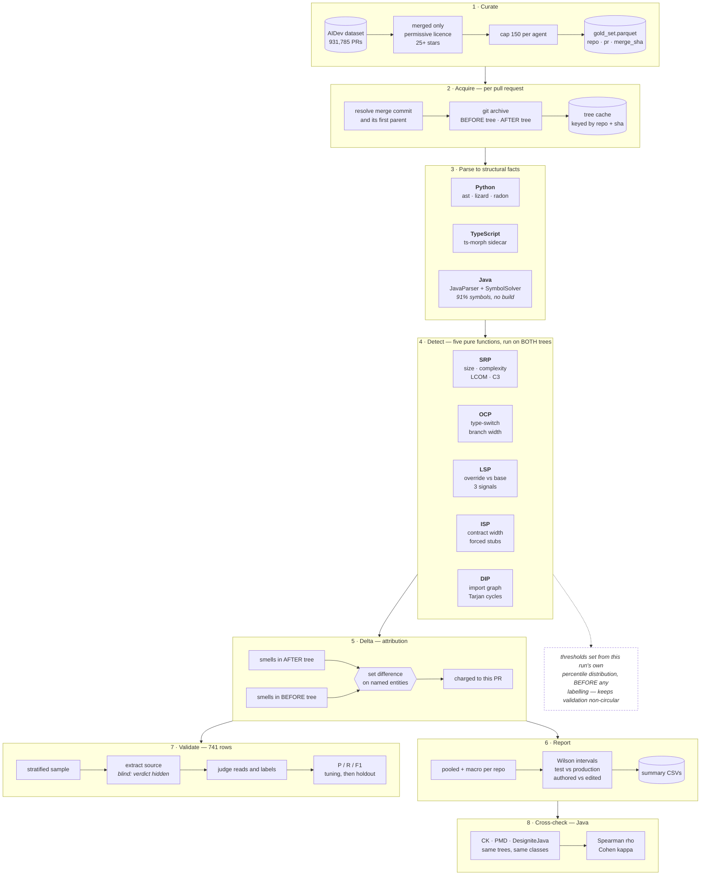

  

<h1 align="center">VibeBench</h1>

  <b>Do AI coding agents write code worth maintaining?</b> 
  A design-quality benchmark on real merged pull requests.

---

Every benchmark for coding agents asks *"does the code work?"* — SWE-bench, HumanEval,
LiveCodeBench all measure functional correctness. This one asks whether the code is worth
maintaining, by measuring adherence to the five SOLID design principles on pull requests that
five agents actually got **merged** into real repositories.

Each principle is measured by a deterministic structural proxy, computed on the **before/after
delta** of each PR, and validated against a reading judge and three independent published tools.

## How it works

**Detect** is pure — no file access, no git, no network. It takes a `{path: source}` dict and
returns findings, so it is testable in isolation, and every threshold lives in one config file.
Each detector self-checks when run as a script.

**Delta** is a *set* comparison, not a subtraction: named smell entities present after the merge
but absent at its parent. That is what attributes a violation to the pull request that created it
rather than to the repository that already had it — and it is why a PR that *removes* a module
from a cycle is not charged for one.

**Both halves are scoped by ripple**, not just by the edited file: a base-class change that breaks
an untouched subclass is still attributed, since the relation is what the principle is about.